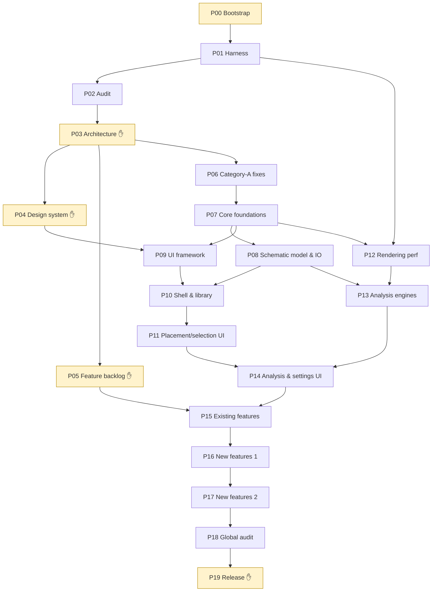

# 02 — Roadmap: 20 phases, two parallel tracks, audited gates

> Every phase has a self-contained **implementation prompt** and an **independent audit prompt** in `prompts/`. A failed audit triggers `prompts/correction-template.md`, then a delta re-audit.
> Sizes are relative effort classes (S < M < L < XL), not calendar promises. Each class assumes one Claude Code lead session plus a few subagents. Any phase whose plan exceeds its size class must be split (for example P12a/P12b) **before** implementation starts.

## 1. Overview

| # | Phase | Track | Size | Depends on | Human checkpoint | Main outcome |
|---|---|---|---|---|---|---|
| P00 | Bootstrap, fork and baseline preservation | Setup | S | — | **Yes**: identity, owner, contact | Fork, remotes, branches, baseline tag, Claude Code kit, tracking docs, build verified |
| P01 | Test and measurement harness | Setup | L | P00 | No | JUnit + client game tests, schematic corpus, golden-master tests, JFR benchmark harness, CI, baseline numbers |
| P02 | Deep technical and functional audit | Discovery | L | P01 | Review the report | Problem register (ranked), feature inventory, journey map, keep/improve/replace/remove matrix, upstream intel |
| P03 | Target architecture and migration plan | Design | M | P02 | **Yes**: ADR approval | Vision, ADRs (identity, layering, threading, data model, UI approach, compat), migration plan, metric targets |
| P04 | Design system and GUI mockups | Design | M | P03 | **Yes**: mockups approval | Design tokens, components, IA, HTML mockups at real GUI scales, in-game feasibility spike |
| P05 | Feature specification and backlog | Design | M | P03 (∥ P04) | **Yes**: feature selection | Feature cards (value, cost, constraints, interactions, server-rule review, A/B/C), prioritised backlog |
| P06 | Upstream-ready fixes (Category A, batch 1) | Upstream | M | P02, P03 | Approve PR list | 5–10 isolated, tested fixes on `upstream-pr/*` branches + merged into the fork |
| P07 | Core foundations: context, lifecycle, jobs, errors | Core | L | P03, P06 | No | `LitematicaContext`/services, lifecycle state machine, job system with progress/cancel, error reporting, feature flags, config migration |
| P08 | Schematic model and I/O foundations | Core | L | P07 | No | `Schematic` interface + codecs, async load, atomic save + backups, validation/repair report, metadata index |
| P09 | UI framework and pilot screen | UI track | L | P04, P07 | Playtest | Fork UI toolkit (tokens, layout, components, virtual lists, focus/keyboard), screenshot tests, 1 migrated screen |
| P10 | Navigation shell and schematic library | UI track | L | P09, P08 | Playtest | Task-first shell, command palette, library (search, filters, tags, thumbnails), load/save flows |
| P11 | Placement, selection, tools and HUD | UI track | L | P10 | Playtest | Redesigned placement/selection/sub-region editors, tool HUD/context menu, info overlays |
| P12 | Rendering performance | Perf track (∥ P09–P11) | XL | P07, P01 | Playtest + numbers | Off-thread meshing, adaptive frame budget, upload scheduling, memory reductions, Sodium/Iris/Voxy matrix, before/after |
| P13 | Analysis engines: verifier, materials, diff | Core | L | P08, P12 | No | Headless incremental verifier, material engine, diff engine, off-thread with snapshots, before/after |
| P14 | Verifier, materials, projects and settings UI | UI track | L | P13, P11 | Playtest | New analysis screens, build-assistant panel, searchable settings, keymap editor |
| P15 | Existing feature improvements | Features | L | P14, P05 | Playtest | Easy Place correctness and safety, paste/command tasks, edit mode, projects/VCS, formats, profiles |
| P16 | New features, wave 1 | Features | L | P15 | Playtest | Selected items from the backlog (e.g. build progress/ETA, storage-aware materials, layer sheets, recovery) |
| P17 | New features, wave 2 | Features | L | P16 | Playtest | Selected advanced items (e.g. schematic diff/compare, grid placements, health check/remap, add-on API) |
| P18 | Global adversarial audit and hardening | Quality | L | P17 | Review the report | Fresh multi-agent audit, regression hunt, edge-case suite, compat and perf re-verification, fixes |
| P19 | Stabilisation, release and upstream packaging | Release | M | P18 | **Yes**: release and PR go/no-go | Release candidate, docs, versioning, disclosure, fork publication, PR series ready |

Recurring procedures (prompts in `prompts/recurring/`):
- **MC version port** (run after each Minecraft game drop, between phases);
- **Upstream sync** (merge new Sakura-Ryoko releases);
- **PR extraction** (turn a fork change into a minimal upstream PR).

## 2. Dependency graph



**Parallelism.** P04 ∥ P05 ∥ P06 after P03. P12 runs in parallel with P09–P11, because they touch disjoint trees (`render/**` + `world/**` versus `gui/**` + `ui/**`). Run them in **separate git worktrees and separate Claude Code sessions**, each with its own audit. Merge P12 before P13 starts. If you prefer a single line of work, run the phases in numeric order: the prompts work either way.

## 3. Why this order

- **Tests and measurements first (P01).** Without them, every later "optimisation" or "refactor" claim is unverifiable. The rules forbid invented benchmarks.
- **Audit before design (P02 → P03).** Architecture decisions must rest on measured bottlenecks and real usage, not on taste.
- **Mockups before GUI code (P04 → P09).** You approve the visual direction while it is still cheap to change.
- **Early upstream fixes (P06).** These are high-value, low-risk changes (atomic save, overflow guard…). They protect users now, test the PR pipeline, and start the relationship with the maintainers before any big proposal.
- **Foundations before features (P07–P08).** New features rely on jobs, lifecycle, the schematic model and the index. Building them on the old static-state core would double the work.
- **Engines before analysis UI (P13 → P14).** The verifier/material screens need the new incremental data model.
- **Improve before adding (P15 → P16/P17).** Existing users benefit first. New features then reuse improved subsystems.
- **Adversarial audit at the end (P18),** after every subsystem has changed, with fresh agents that never saw the work.

## 4. Gates: definition of done for every phase

A phase is **done** only when all of these hold:
1. `./gradlew build` and the full test suite pass from a **clean checkout** of the phase branch. Compiling is necessary but **never sufficient**.
2. Every acceptance criterion in the phase prompt has **evidence** in `docs/enhanced/phases/PXX/report.md` (claims ledger: claim → command → raw output/file).
3. There are **no benchmark regressions** beyond the thresholds in `03-reference-documentation.md §6`, unless an ADR justifies them and you approve.
4. Tracking files are updated: `STATE.md`, `ROADMAP.md` row, registers, knowledge maps, ADRs.
5. The independent audit verdict is **PASS** (or PASS WITH RESERVATIONS, with each reservation logged as a tracked item and accepted by you).
6. The human checkpoint, if listed, has been passed and recorded in `docs/enhanced/DECISIONS.md`.
7. The phase branch is merged into `enhanced/main` with a merge commit, and tagged `enhanced/pXX-pass`.

**Rollback**: every phase starts from a tag. A failed phase is abandoned by resetting `enhanced/main` to the previous `enhanced/pXX-pass` tag. Risky subsystems also ship behind **feature flags** with the legacy path kept until parity is proven (see the reference documentation §4.7).

## 5. Per-phase workflow (what you actually do)

```text
1. git switch enhanced/main && git pull
2. git switch -c phase/PXX-<slug>
3. Start Claude Code at the repo root, paste prompts/phase-XX-…-implementation.md
   (design-heavy phases: start in plan mode, approve the plan, then let it implement)
4. When it finishes: read docs/enhanced/phases/PXX/report.md (≤ 2 pages)
5. Open a NEW session (fresh context, ideally a separate worktree or clone),
   paste prompts/phase-XX-…-audit.md, giving it the base tag and the branch name
6. PASS → merge, tag, update STATE.md (the audit prompt tells you the commands)
   FAIL → prompts/correction-template.md with the finding IDs → delta re-audit
7. Human checkpoint if listed → record decision in DECISIONS.md
```

## 6. Phase summaries (details live in each prompt)

- **P00 Bootstrap (S).**
  - Confirm upstream identity and licence.
  - Create the fork, remotes and branches. Tag the pristine baseline.
  - Verify that the build works on your machine and in CI.
  - Install the Claude Code kit (CLAUDE.md, agents, rules, settings, hooks) and the `docs/enhanced/` skeleton.
  - Fix the `fabric.mod.json` contact URLs **only in the fork's identity patch**. No functional change.
- **P01 Harness (L).**
  - Fabric Loader JUnit, plus a client game-test source set (Fabric API in **test scope only**).
  - Deterministic synthetic schematic generator and corpus.
  - Golden-master tests for format round-trips, transforms, verifier and material counts.
  - JFR benchmark scenarios, a results schema, a comparison script, CI with tests.
  - Baseline benchmark report.
  - Production code changes are limited to non-behavioural test seams, and each one is documented.
- **P02 Audit (L).**
  - Five parallel read-only investigations: architecture, performance (with measurements), reliability/security/compat, UX/journeys/feature inventory, upstream intelligence (issues, PRs, add-ons, rewrite diff).
  - Consolidation into ranked registers, then an internal adversarial review.
- **P03 Architecture (M).**
  - ADRs: fork identity/mod id/`provides`, package namespaces, layering and modules, version adapter layer, threading model, schematic data model, UI framework approach, compatibility (formats, configs, add-ons, mods), feature flags, telemetry-free diagnostics.
  - Migration plan with the strangler steps and metric targets based on P01/P02 baselines.
- **P04 Design (M).**
  - UX principles, information architecture, design tokens (palette, contrast, spacing on the GUI pixel grid, typography with the vanilla font), component catalogue.
  - HTML mockups of the key screens at GUI scales 2/3/4 and in a narrow window.
  - An in-game spike that renders 2–3 components to prove feasibility.
  - You approve before P09.
- **P05 Features (M).**
  - Exhaustive feature cards (existing and new) with value, users, constraints, cost, risks, interactions, server-fairness review, upstream category.
  - Scoring and a proposed cut for P15/P16/P17. You select.
- **P06 Category-A fixes (M).** For each fix:
  - a failing test first, then a minimal fix on an `upstream-pr/<topic>` branch cut from the vendor branch;
  - the same fix merged into the fork;
  - a PR description draft with honest AI disclosure.
  Candidates: REL-01 atomic save, REL-02 overflow guard, REL-03 transmit slice index (after verification), PERF-02 safe default budget, commented-out-code removal in touched files only.
- **P07 Core (L).** Services/context replacing static access behind facades, lifecycle state machine (join/leave/dimension/exit), job system (progress, cancel, priorities, main-thread handoff, budget), error and diagnostics reporting, feature-flag registry, config schema version and migration. No visible behaviour change.
- **P08 Data/IO (L).** `Schematic` interface and per-format codecs (rewrite-aligned), metadata-only fast read, async load with progress/cancel, atomic save with backups, validation and repair report, size guards, metadata index (sidecar cache), fuzz tests, memory accounting.
- **P09 UI kit (L).** Fork-owned UI layer: tokens, layout, focus and keyboard navigation, scroll/virtualised lists, text input, dropdowns, toasts, dialogs, tooltips/help, icon atlas pipeline (human-made or placeholder art), screenshot tests at several GUI scales. Migrate one low-risk screen (for example the Task Manager) behind a flag.
- **P10 Shell and library (L).** New entry point (task-first home), command palette, schematic library (index-backed search, filters, sorting, tags, favourites, recents, thumbnails, drag-and-drop import), load/save/convert flows on async jobs. Legacy screens stay reachable until parity.
- **P11 Placement and selection (L).** Placement list and editor, sub-regions, transforms with live preview, area selection editors (normal/simple), tool HUD and contextual menu, info overlays restyled. Same features, fewer steps.
- **P12 Rendering perf (XL, may split into a/b).** Off-thread meshing from immutable snapshots, adaptive budget, upload prioritisation, dirty-region granularity, buffer pooling, memory reductions in the schematic world, compat with Sodium/Iris/Voxy, kill switch to the legacy path, before/after on the fixed protocol.
- **P13 Engines (L).** Verifier, material and diff engines as headless, incremental, snapshot-based services with primitive collections. Results feed both the HUD and the GUI. Before/after measurements.
- **P14 Analysis UI (L).** Verifier screen and overlays, material list with planning, schematic projects/VCS screens, searchable settings with profiles and "changed only", keymap editor with conflicts.
- **P15 Existing features (L).** Easy Place correctness (all block families) and fairness (causality rule, server policy, per-server profiles), paste/command tasks (robustness, progress, resumable, dry-run), schematic edit mode, projects/VCS, conversions and downgrade, pick block, i18n gaps.
- **P16–P17 New features (L each).** Only the items you selected in P05, each with a spec, tests, UI integration, docs and an interaction review.
- **P18 Global audit (L).** Fresh agents: regression hunt against P01 golden masters, edge-case and fault-injection suite, perf re-verification, compat matrix, server-fairness audit, docs-vs-behaviour check. Fixes go through correction prompts.
- **P19 Release (M).** Release candidate, changelog, user guide, migration notes, version scheme, licence/attribution/notice files, AI disclosure text, distribution decision, upstream PR series (A first, B as proposals).

## 7. Tracking and status

`docs/enhanced/ROADMAP.md` in the repo mirrors the table above with a **Status** column (`todo / in-progress / in-audit / correcting / passed / skipped`), the audit verdict, the merge commit and the tag. `docs/enhanced/STATE.md` always states **the current phase, the last verified commit, open blockers and the very next action**. It is the first file every session reads.
