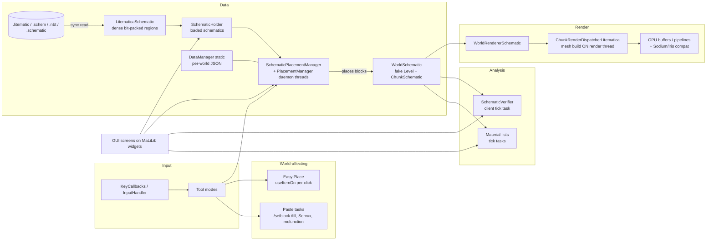

# 01 — Strategic Analysis: Litematica Enhanced

> Status: planning baseline, written 2026-11-06.
> Scope: the modern Fabric line of Litematica and its MaLiLib dependency, plus masa's rewrite branches as an architectural reference.
> Method: shallow clones of the real repositories, static inspection (structure, sizes, call paths, configuration, build), and public sources (Modrinth, CurseForge, Fabric docs, Claude Code docs). **Nothing in this document comes from running the mod.** Every performance statement below is a *hypothesis to be measured in Phase 1/2*, never a result.

---

## 0. Executive summary

1. **There is no single "official repository" for modern Litematica.** The original author, masa (`maruohon`), announced in 2024 that he would no longer maintain the 1.20.5+ versions himself. Sakura-Ryoko maintains those ports. masa's own active work is a long-running **rewrite on Ornithe 1.12.2** (`maruohon/litematica@ornithe/1.12.2`, `maruohon/malilib@ornithe/1.12.2`, last commits 2026-10-18).
   → The practical upstream for a modern fork is **`sakura-ryoko/litematica` (default branch `26.3`)** and **`sakura-ryoko/malilib`**. masa's rewrite is the **architectural north star**: aligning with it maximises the chance that ideas get accepted.
2. **Baseline (2026-11-06):** Minecraft **26.3** (released 2026-09-15), Java **25**, Fabric Loader 0.19.5, Loom 1.18, MaLiLib 0.30.2, Litematica `0.29.2-sakura.1`. The code base is ~**316 Java files / ~73k lines**. It has **zero automated tests**, and CI only builds.
3. **Minecraft 26.1+ is unobfuscated, and Fabric no longer maintains Yarn.** The 26.x code already uses Mojang names, so the fork starts from the new world. It gets no benefit from staying on 1.21.x. Quarterly game drops (26.1, 26.2, 26.3…) make **porting cost** a first-class architectural concern.
4. **The single most consequential non-technical constraint is AI policy.** Since 2026-08-13, Modrinth requires AI disclosure and **refuses projects that are "entirely or primarily" AI-generated**. It also prohibits AI-generated images on project pages. Sakura-Ryoko's PR template requires an **AI disclosure**. A Claude-Code-driven programme must therefore keep a **human author in the loop for decisions, review and testing**, disclose honestly, and plan distribution (GitHub Releases first) accordingly.
5. **Main technical findings (from code, to be confirmed by measurement):**
   - Schematic **chunk meshing runs on the render thread**. By default it runs with **no time budget** (`renderThreadNoTimeout = true`). The multi-thread option has been commented out. The frame budget hard-codes 60 FPS with a `TODO 1.15+`.
   - **Schematic files load synchronously from GUI handlers**, so a large file freezes the game.
   - **Schematic saves are not atomic**: the file is opened and overwritten in place. A crash during "override" can destroy the previous file. (JSON data files *are* written temp-then-rename.)
   - **Block data is held at least twice**: once in the schematic container and once in the fake `WorldSchematic` chunks, plus GPU meshes and verifier maps.
   - The architecture leans on **global static state**: about 326 `getInstance()` calls, and `DataManager` is referenced from 81 files. It also has **very large classes** (`LitematicaSchematic` is 3,426 lines) and about **1,350 lines of commented-out code**.
   - Some features are **dormant or incomplete**: material-list container scanning is commented out, the render-thread-count option is commented out, and the schematic transmit API is `@Deprecated(forRemoval)`.
6. **masa's rewrite already solves several structural problems**: a `Schematic` interface with one implementation per format, a sparse block container, grid placements, a verifier manager, and a much richer GUI toolkit in MaLiLib 0.60 (tabbed screens, action system, overlays, registry). Porting *designs* (not code wholesale) from it is the cheapest path to a better architecture **and** the most upstream-friendly one.
7. **The UX opportunity is big.** There are 175 configuration options and 78 hotkeys behind a fixed button-grid main menu. The file browser only offers name filtering and alphabetical sorting. Third-party add-ons fill the gaps users feel, such as in-game schematic browsers, material checklists with storage tracking, and chunk-lag fixes. Those add-ons are free market research.
8. **Recommended strategy:** *incremental modernisation of the Sakura line, steered by masa's rewrite designs* (a "rewrite-aligned strangler"). Build test and measurement foundations first, then data/IO and threading foundations, then UI and performance in parallel tracks, then features. Do not attempt a clean-room rewrite.
9. **The rule on server fairness must be architectural, not just documentary**: "every world-affecting packet is caused by an explicit user input". No printer, no autonomous building, and an optional server-declared feature policy.
10. **Fork identity needs a decision early (Phase 3)**: a distinct mod id that `provides: litematica` (so add-ons keep working), its own issue tracker, and a name that does not imply endorsement. **Permission from the maintainers should be requested before using "Litematica" in the public name.**

---

## 1. Project identification and governance

### 1.1 Repositories that matter

| Repository | Role | Observed state (2026-11-06) |
|---|---|---|
| `github.com/sakura-ryoko/litematica` | **Maintained modern line** (Fabric) | Default branch `26.3`; `LTS/1.19.4 … LTS/26.2` branches; tags such as `26.3-0.29.0`; HEAD `64e7459` (2026-10-07); contributors are mostly Sakura-Ryoko plus Weblate and occasional contributors; has a PR template with AI disclosure |
| `github.com/sakura-ryoko/malilib` | Maintained library line | Default branch `26.3`; same LTS layout; HEAD `b043d04`; ~588 files / ~87k lines |
| `github.com/maruohon/litematica` | Original author's repository | Default `ornithe/1.12.2` (**rewrite**, `0.40.1`, ~238 files / ~43k lines); `pre-rewrite/fabric/*` branches stop at `1.21.1-masa` |
| `github.com/maruohon/malilib` | Original library, rewrite | Default `ornithe/1.12.2` (`0.60.2`, ~620 files / ~81k lines) with a new GUI/action/overlay architecture |
| Servux (`sakura-ryoko/servux`) | Optional server companion | Used for entity data sync, server-side paste, and the "accurate placement" protocol |
| Syncmatica (`sakura-ryoko/syncmatica`, forks) | Share placements on a server | Depends on Litematica internals, so it is an **API compatibility constraint** |
| `aleksilassila/litematica-printer`, `aria1th/litematica-printer` | Printer add-ons (automation) | Deliberately outside Litematica; **must stay outside the fork too** |
| Forgematica (NeoForge port) | Third-party port that syncs from Sakura's line | Shows the demand for NeoForge and a possible collaborator |
| Add-ons on Modrinth/CurseForge | Litematic Downloader, Better List for Litematica, Litematica Chunk Lag Fix, Litematica Bobby Fix | **Evidence of unmet needs**: library/browsing, material tracking, chunk-transition stutter, compatibility with cached chunks |

### 1.2 Who is "the principal developer"?
- **masa** owns the project, the name, the CurseForge/Modrinth pages and the long-term vision. His public position is that he does not maintain 1.20.5+ himself, and that issues for those versions belong in Sakura-Ryoko's repositories, not his.
- **Sakura-Ryoko** is the active maintainer of every modern version and the realistic reviewer of PRs against 26.x.
- **Consequences for this programme:**
  - Category-A PRs (small fixes) target **`sakura-ryoko/litematica` or `sakura-ryoko/malilib`, branch `26.3`** (or whatever the current default branch is at the time).
  - Architectural proposals should be **framed as alignment with masa's rewrite** and discussed with both maintainers (Discord/issue) **before** any code is offered.
  - The fork must **never send its users to masa's issue tracker**. The current `fabric.mod.json` points `issues`/`sources` at `maruohon/litematica`, so this must change in Phase 0.

### 1.3 License and distribution constraints
- **LGPL-3.0-only** (Litematica and MaLiLib). A fork must stay under LGPL-3.0, publish its source, keep the copyright and license notices, and **mark modified files with a prominent notice and a date** (GPLv3 §5(a), which LGPLv3 incorporates). *This is not legal advice; check with the license text.*
- **Modrinth (rules updated 2026-08-13):** AI disclosure is mandatory when a substantial portion of the code is AI output. Projects whose contents are "primarily or entirely" AI output may not be published publicly. No AI-generated images on project pages. Forks must "diverge substantially".
  → Plan for: an honest disclosure, real human authorship (decisions, reviews, tests, rejections), **no AI-generated textures/icons in the shipped mod if Modrinth is a target**, and GitHub Releases as the primary channel until eligibility is clear.
- **CurseForge** has an "AI Misleading Content Disclosure" moderation policy and rules against reuploads with minimal changes. Check the current text before publishing there.
- **Sakura-Ryoko's PR template** asks contributors to tick what AI did (code generation, assets, documentation). Every upstream PR from this programme **must fill it in truthfully**. Expect some PRs to be declined for that reason alone, and do not argue.
- **Naming:** Modrinth forbids implying endorsement or affiliation. "Litematica Enhanced" may be read that way. Ask masa/Sakura-Ryoko, or choose a distinct name with a subtitle such as "an unofficial Litematica fork".

---

## 2. Baseline snapshot (measured from the repositories)

| Metric | Value | Source |
|---|---|---|
| Minecraft / Java | 26.3 / 25 | `gradle.properties`, `build.gradle` (`options.release = 25`) |
| Loader / build | Fabric Loader 0.19.5, `net.fabricmc.fabric-loom` 1.18.+ | `gradle.properties`, `build.gradle` |
| Dependencies | MaLiLib 0.30.2 (masa maven), conditional-mixin (included), compileOnly ModMenu and Iris; Sodium 0.9.2 referenced; **Fabric API not a runtime dependency** (lines commented out) | `build.gradle` |
| Code size | 316 Java files, ~73k lines | `find`/`wc` |
| Largest classes | `LitematicaSchematic` 3,426 · `ChunkRendererSchematicVbo` 1,640 · `SchematicDowngradeConverter` 1,616 · `WorldRendererSchematic` 1,616 · `EasyPlaceUtils` 1,418 · `SchematicPlacementManager` 1,318 · `SchematicPlacement` 1,288 · `TaskPasteSchematicPerChunkCommand` 1,255 · `RayTraceUtils` 1,253 · `SchematicUtils` 1,252 | `wc -l` |
| Largest packages | `util` 11.3k · `render/schematic` 8.0k · `gui` 7.3k (+3.7k widgets) · `schematic/placement` 5.1k · `schematic` 5.0k | `wc -l` per package |
| Mixins | 52 mixin classes (23 common, 29 client), ~53 injections, 0 `@Overwrite`/`@Redirect`; access widener with 11 lines | `mixins.litematica.json`, grep |
| Configuration | 175 config options (Generic, Visuals, InfoOverlays, Colors) + 78 hotkeys | `config/Configs.java`, `config/Hotkeys.java` |
| Localisation | 1,184 English keys; 15 languages at 100% key coverage (Weblate) | `assets/litematica/lang` |
| Tests | **0** test sources; MaLiLib has manual test screens inside `src/main` | `find` |
| CI | GitHub Actions: build only (Java 25, Ubuntu) | `.github/workflows/build.yml` |
| Hygiene indicators | ~1,357 commented-out code lines · 66 TODO/FIXME · 24 `@Deprecated` · 326 `getInstance()` · `DataManager` used in 81 files | grep |

---

## 3. As-is architecture (simplified)

**Key flows:**
1. **Load**: GUI → `LitematicaSchematic.createFromFile` (synchronous) → `SchematicHolder`.
2. **Place**: `SchematicPlacementManager` → placement daemon tasks copy blocks into `WorldSchematic` chunks.
3. **Render**: `WorldRendererSchematic.setupTerrain/updateChunks` → dispatcher → `rebuildChunk` on the render thread → upload.
4. **Verify**: a tick task compares `WorldSchematic` with the client world, chunk by chunk.
5. **Act**: Easy Place intercepts `useItemOn`. Paste uses commands, Servux or `.mcfunction` export.

---

## 4. Findings by axis

Each finding has an **ID** that the audits and registers reuse. **Confidence**: *Observed* = seen in code; *Hypothesis* = plausible impact that still needs measurement. **Category**: A = easy to upstream, B = needs discussion, C = fork-only.

### 4.A GUI / UX

| ID | Finding | Evidence | Confidence | Direction | Cat. |
|---|---|---|---|---|---|
| UX-01 | The main menu is a fixed grid of buttons that maps to code modules (Placements, Loaded, Load, Area Editor, Area Browser, Configuration, Manager, Task Manager, Projects), not to user tasks (*build from a schematic*, *capture an area*, *check my build*) | `gui/GuiMainMenu.java` | Observed | Task-oriented navigation shell plus a command palette | C (B for the palette) |
| UX-02 | 175 options in 4 flat tabs. Finding a setting means knowing its name | `config/Configs.java`, `gui/GuiConfigs.java` | Observed | Grouped, searchable settings with presets/profiles, "changed from default" view, inline help | B |
| UX-03 | 78 hotkeys, mostly multi-key combos, with no visible conflict detection or discoverability | `config/Hotkeys.java` | Observed (conflicts: Hypothesis) | Keymap editor with conflict detection, context-aware keymaps, cheat-sheet overlay | B |
| UX-04 | The schematic browser filters by file name and sorts alphabetically. There is no metadata search (size, block count, author, version, date), tags, favourites or recents, and no thumbnails in the list | `WidgetFileBrowserBase` (MaLiLib), `GuiSchematicBrowserBase` | Observed | Indexed library with metadata cache, thumbnails, tags, collections and filters | C (index cache: B) |
| UX-05 | The same GUI stack is shared by every masa mod (MaLiLib `GuiBase`, `WidgetListBase`), so visual changes in MaLiLib affect Tweakeroo, MiniHUD and the rest | MaLiLib `gui/*` | Observed | Build the new design system **in the fork**, on vanilla primitives and MaLiLib services. Do not fork MaLiLib's look | — |
| UX-06 | Long operations (load, paste, verify, material list) report progress through the HUD or chat messages. Cancellation and progress handling are inconsistent | `scheduler/*`, `InfoUtils` usage | Hypothesis | Unified "jobs" model: progress, cancel, history, notifications | B |
| UX-07 | No onboarding. Knowledge lives in Reddit/Discord posts linked from the mod page | CurseForge description | Observed | Contextual help, first-run guide, "why is nothing rendering?" diagnostics | C |
| UX-08 | The verifier and material list are powerful but dense, and turning results into action ("go to the next missing block", "what do I gather next?") takes many steps | `GuiSchematicVerifier`, `GuiMaterialList` | Hypothesis (needs journey testing) | Build-assistant panels: next-step guidance, filters, per-layer progress | B/C |

### 4.B Performance (all *hypotheses* until Phase 1/2 measures them)

| ID | Finding | Evidence | Direction | Cat. |
|---|---|---|---|---|
| PERF-01 | **Mesh building runs on the render thread.** `ChunkRenderWorkerLitematica.processTask` calls `rebuildChunk` synchronously from `runChunkUploads` | `render/schematic/ChunkRenderWorkerLitematica.java:85`, `ChunkRenderDispatcherLitematica.java:69-114` | Off-thread meshing over immutable section snapshots, uploads on the render thread, with a priority queue by distance | B |
| PERF-02 | **No frame budget by default**: `renderThreadNoTimeout` defaults to `true`, so `finishTimeNano = Long.MAX_VALUE`. Otherwise the budget is half a frame at a **hard-coded 60 FPS** (`// TODO 1.15+`) | `config/Configs.java:130`, `render/LitematicaRenderer.java:104-116` | Adaptive budget from measured frame time. Default must not stall frames | A |
| PERF-03 | The old multi-thread render option has been removed (commented out) | `config/Configs.java:256` | Reintroduce threading safely (PERF-01) | B |
| PERF-04 | **Synchronous schematic loading from GUI handlers** (decompress + parse + convert on the client thread) | `gui/GuiSchematicLoad.java:247,335`, `data/SchematicHolder.java:47` | Async load with progress and cancellation; preview from a metadata-only read | A/B |
| PERF-05 | **Data held twice or more**: dense schematic container + `WorldSchematic` chunks (vanilla-like sections) + GPU meshes + verifier position lists | `schematic/container/*`, `world/ChunkSchematic.java` (extends `LevelChunk`) | Measure retained heap per placement; consider a lazily materialised or shared-palette schematic world, and sparse containers (as in masa's rewrite) | B |
| PERF-06 | The verifier stores per-category `ArrayListMultimap<Pair<BlockState,BlockState>, BlockPos>` and `HashSet<BlockPos>`: boxed positions and many allocations on big builds | `schematic/verifier/SchematicVerifier.java:48-64` | Primitive long-packed positions, incremental per-chunk results, off-thread diffing | B |
| PERF-07 | Analysis tasks (verifier, block counting) run as client-tick tasks | `scheduler/TaskScheduler.java`, `SchematicVerifier.execute` | A budgeted job system and off-thread compute where reads are snapshot-safe | B |
| PERF-08 | The placement manager daemon (added recently) uses a platform thread pool sized at cores/4 with deferred queues. Thread-safety against render and tick readers is not documented | `schematic/placement/PlacementManagerDaemonHandler.java` | Document the thread model, add stress tests | A (docs/tests) |
| PERF-09 | Third-party "Litematica Chunk Lag Fix" add-on exists for chunk-transition freezes on huge schematics | CurseForge | Treat this as a **user-reported symptom to reproduce** in the benchmark suite | — |

### 4.C Features

- **Existing (to inventory exhaustively in Phase 2):**
  - Formats: `.litematic` v7 with v6 downgrade export, Sponge `.schem` v1–v3, vanilla structure `.nbt`, Schematica/MCEdit `.schematic`.
  - Placements and sub-regions with rotation, mirror and origin. Render layers.
  - Area selection in Normal and Simple modes, with sub-regions. Saving from an area or in memory.
  - Schematic verifier. Material lists (placement, area, schematic) with HUD and JSON export.
  - Info overlays.
  - Tool modes: area selection, placement, fill, replace, paste, grid paste, move, delete, rebuild/edit.
  - Easy Place (V2/V3 protocols, slabs only, hold mode, swap interval). Pick block.
  - Paste by commands, by Servux, or as `.mcfunction`. Schematic projects (VCS). Task manager.
  - Servux entity-data sync. Iris, Jade, ModMenu and Voxy compat.
- **Dormant or incomplete:** material-list container scan (3 options commented out), the `loadEntireSchematics` option hidden from the GUI list, the render thread-count option, the schematic transmit API (deprecated, experimental).
- **Signals of unmet needs** from add-ons:
  - Litematic Downloader: in-game browsing, file manager, sharing links.
  - Better List: material checklist, tracked chests, party sync.
  - Syncmatica Revolution: shared material progress and claims.
  - Chunk Lag Fix and Bobby Fix: performance and compatibility.

### 4.D Architecture and code quality

| ID | Finding | Evidence | Direction |
|---|---|---|---|
| ARCH-01 | Global static state everywhere (`DataManager`, singletons) makes testing and lifecycle (world change, disconnect) fragile | 326 `getInstance()`, `DataManager` in 81 files | Introduce an explicit `LitematicaContext`/services and migrate step by step (strangler) |
| ARCH-02 | God classes: `LitematicaSchematic` mixes the data model, 4 format readers, writers, conversion, entity handling and Servux transmit | 3,426 lines | Split into `Schematic` model + per-format codecs + services (as in masa's rewrite) |
| ARCH-03 | `WorldSchematic` is a fake `Level` with fake chunks. It reuses vanilla rendering but couples deeply to version internals (52 mixins, many accessors), which drives the quarterly porting cost | `world/*`, `mixin/*` | Keep the approach (it works) but **isolate version-sensitive code behind adapters**, and record each mixin's purpose in a mixin register |
| ARCH-04 | Utility classes over 1,000 lines (`util/*`), which hide domain logic | `util` 11.3k lines | Move logic into domain services; keep utils pure and tested |
| ARCH-05 | About 1,350 lines of commented-out code and many commented debug logs | grep | Remove during refactors, with git history as the archive (one PR per area) |
| ARCH-06 | No tests means every port relies on manual play-testing. Commit history shows frequent "fix:" follow-ups after ports | git log | Characterisation tests first (Phase 1), then unit and game tests |
| ARCH-07 | Version-independent NBT abstraction (`CompoundData`) already exists in MaLiLib | `malilib/util/data/tag/*` | Build on it. Do not reinvent |

### 4.E Reliability, security, compatibility

| ID | Finding | Evidence | Confidence | Direction | Cat. |
|---|---|---|---|---|---|
| REL-01 | **Non-atomic schematic writes.** With `override=true`, the target is truncated and written in place. A crash or power loss can corrupt the existing file | `LitematicaSchematic.writeToFile` → MaLiLib `DataFileUtils.java:69` (`Files.newOutputStream(file)`) | Observed | Temp file in the same directory + flush/fsync + atomic move; optional `.bak` rotation | **A** (MaLiLib PR) |
| REL-02 | Region index uses `int`: `getIndex` returns `y*sizeLayer + z*sizeX + x`, and `sizeLayer = sizeX*sizeZ` is an `int`. It overflows above 2³¹ cells even though `totalVolume` is `long` | `schematic/container/LitematicaBlockStateContainer.java:132,190-192` | Observed (reachability: Hypothesis) | Validate sizes at load/creation, use `long` arithmetic, give the user a clear error | A |
| REL-03 | The transmit sender writes `putInt("Slice", totalSlices)` for **every** slice (probably meant `currentSlice`) | `LitematicaSchematic.java:1592` | Observed; impact needs the Servux protocol | Confirm with the Servux code, then fix or document | A |
| REL-04 | Read path: GZIP with uncompressed fallback, 512 MB size tracker, and errors surfaced as generic messages. No structural validation report (palette bounds, unknown blocks, data version) | MaLiLib `DataFileUtils`, `SizeTracker.FILE_MAX_BYTES` | Observed | Validation + repair report ("schematic health check"); fuzz the readers | A/B |
| REL-05 | JSON data (placements, selections, configs) uses temp+rename by default (good) but **no fsync**, and corruption recovery is limited | MaLiLib `FileUtils.writeDataToFile` | Observed | Keep a backup of the last good file, plus a recovery path on parse failure | A |
| REL-06 | Lifecycle edge cases (dimension change, disconnect, game exit during paste, save or load) are handled ad hoc. Recent commits fix placement threads across dimension changes | changelogs, `PlacementManagerDaemonHandler` | Hypothesis | Lifecycle state machine + tests for each transition | B |
| REL-07 | Easy Place clicks the air block at the target position. CurseForge warns this "can easily be detected by anti-cheat systems", and it may get players banned | CurseForge description | Observed | Keep the feature off by default, warn clearly, provide per-server profiles and respect server policy (Section 8) | B |
| REL-08 | Shader compatibility: schematic rendering has been reported as not working properly with shaders (Iris) on recent versions | Mod page text, Iris compat package | Observed (current status: verify) | Compat matrix + rendering path tests with Sodium/Iris/Voxy | B |
| SEC-01 | Untrusted input surfaces: schematic files from the internet, Servux/Syncmatica payloads, `.mcfunction` generation (command injection through block NBT strings?) | `network/*`, `TaskPasteSchematicSetblockToMcfunction` | Hypothesis | Threat model + fuzzing + escaping review | A |

---

## 5. What masa's rewrite already offers (design donor)

| Topic | Sakura 26.3 line | masa rewrite (Ornithe 1.12.2) | Use in the fork |
|---|---|---|---|
| Schematic model | One `LitematicaSchematic` god class; Sponge/vanilla converted into it | `Schematic` interface; `LitematicaSchematic`, `SpongeSchematic`, `VanillaSchematic`, `SchematicaSchematic`, `StructurizeSchematic`, `IndevWorldSchematic`; `SchematicType`; `SchematicSaveSettings` | **Adopt the design** (Phase 8) |
| Block storage | Dense bit-packed container, hash/linear palettes | `BlockContainer` hierarchy incl. `SparseBlockContainer`, `ArrayBlockContainer`, several packed int arrays | Sparse/dense selection by fill ratio (Phase 8/13) |
| Placements | Placement + sub-regions | Adds `GridPlacementManager`/`GridSettings`, saved placements browser | Grid/array placements (Phase 17) |
| Verifier | One class acting as task, results and HUD | `SchematicVerifier` + `SchematicVerifierManager` + typed result/status classes | Split engine/presentation (Phase 13) |
| GUI toolkit | `GuiBase` + widget lists | `BaseScreen`, `BaseTabbedScreen`, `BaseListScreen`, `BaseMultiListScreen`, action system, overlays, registry, import/export screens | Inspiration for the fork's own UI layer (Phases 4/9) |
| Utilities | Huge `util` package | Domain-scoped utils (`SchematicCreationUtils`, `SchematicEditUtils`, `SchematicFileUtils`…) | Target package layout (Phase 3) |

> Porting rule: **port designs and interfaces, re-implement against 26.x APIs, and credit masa in the code and docs.** Never copy 1.12-era code that depends on old APIs.

---

## 6. Ecosystem and competition

- **Axiom** (closed source, ARR) is the UX benchmark for builders:
  - a context menu on a held key,
  - an editor mode with movable windows,
  - a blueprint browser tuned for search and preview,
  - a history panel and real-time previews.
  - Lesson: **fast access to the right tool beats a deep menu tree.** Do not copy its look; learn from its interaction model.
- **WorldEdit/FAWE** are server-side editing tools, a different trust model. Litematica's strength is staying **client-side and survival-friendly**.
- **Add-ons:** Litematic Downloader, Better List, Syncmatica (and its *Revolution* fork), the printers. They show demand, and they also **depend on Litematica internals**. Breaking them is a real cost, so keep an **add-on compatibility matrix**.

---

## 7. Strategic options

| Option | Description | Pros | Cons | Verdict |
|---|---|---|---|---|
| **A. Incremental modernisation of the Sakura 26.3 line, steered by masa's rewrite designs** | Keep the working code; add tests; refactor behind seams; replace subsystems one by one | Users keep a working mod at every phase; small upstreamable PRs; low regression risk | Slower to reach a "new" feel; legacy constraints stay for a while | **Recommended** |
| B. Port masa's rewrite to 26.3 | Take `ornithe/1.12.2` code and port it forward | Clean architecture; masa's direction | A dozen major MC versions of API drift (rendering pipeline, data components, registries); duplicates masa's future work; huge, untestable in one go | Use as a **design donor only** |
| C. Clean-room rewrite | New mod with the same goals | Freedom | Loses years of edge-case fixes; highest risk; least upstreamable; weakest human-authorship story for Modrinth | Reject |

---

## 8. Target vision

**Litematica Enhanced = "the reference tool for planning, placing, building and verifying large Minecraft builds, fast and fair on any server."**

Pillars:
1. **Fluid at scale:** no frame drops when large schematics load, move or rebuild. Memory proportional to *visible complexity*, not raw volume.
2. **Task-first UX:** the 10 most frequent journeys take at most 2 interactions from anywhere (palette or contextual menu), and everything else is searchable.
3. **Build assistant:** progress, guidance, material planning and verification that tell the player *what to do next*.
4. **Trustworthy:** atomic saves, recovery, validation, clear errors, no silent data loss.
5. **Fair by design:** visual help and user-initiated assistance only; server policy respected; no automation.
6. **Maintainable and portable:** tested, layered, version adapters, documented mixins. A quarterly MC port stays a bounded task.
7. **Upstream-friendly:** most low-level improvements land as small, tested PRs.

**North-star metrics** (targets are set in Phase 3 from the Phase 1/2 baselines, not invented here):
- p99 frame time while a reference schematic rebuilds;
- time to first render after loading the reference schematic;
- retained heap per placed block;
- number of steps for the top-10 journeys;
- crash-free and data-loss-free sessions in the stress suite;
- port effort per MC version (files touched).

---

## 9. Key risks

| Risk | Likelihood | Impact | Mitigation |
|---|---|---|---|
| Modrinth/CurseForge AI policies block public distribution | Medium-high | High | Human-in-the-loop authorship; honest disclosure; GitHub Releases first; no AI images; decide channel at Phase 19 |
| Upstream declines AI-assisted PRs | Medium | Medium | Small Category-A PRs with tests; ask first; accept "no" gracefully; keep the fork viable on its own |
| Quarterly MC updates break the fork | High | High | Version adapter layer; mixin register; port playbook prompt; test suite; one supported MC version at a time |
| Breaking add-ons (Syncmatica, printers, Better List…) | Medium | Medium | `provides: litematica`; keep the public-ish API stable; compat matrix; deprecation policy |
| Off-thread rendering introduces races or crashes | Medium | High | Immutable snapshots, single-writer rule, stress tests, kill switch config |
| GUI rewrite scope explodes | High | Medium | Design system first; pilot screen; one screen family per phase; keep old screens behind a toggle until parity |
| Benchmarks give false confidence | Medium | High | Fixed protocol, raw data committed, repeated runs, independent re-runs by the auditor |
| Token/time budget overruns | Medium | Medium | Persistent knowledge maps, scoped agents, cheaper models for exploration, short reports |
| Server bans caused by assist features | Low-medium | High | Off by default, per-server profiles, server policy channel, no autonomous actions |
| Legal/branding misunderstanding | Low | High | LGPL notices, distinct identity, permission request, attribution file |

---

## 10. Priorities and sequencing logic

1. **Safety net before change**: baseline tag, build reproducibility, characterisation tests, benchmarks (P0–P1).
2. **Understand before redesign**: multi-agent audit with measurements (P2). Design and architecture decisions (P3), UI design and mockups (P4), feature selection (P5).
3. **Early upstream value**: Category-A fixes such as atomic save and overflow guards (P6). These build trust and validate the PR pipeline.
4. **Foundations**: services/lifecycle/jobs/threading (P7), then schematic model and IO (P8).
5. **Two parallel tracks on disjoint files**: UI track (P9 → P10 → P11) and rendering performance track (P12).
6. **Analysis engines, then their UI** (P13 → P14). Then improved existing features (P15), new features (P16–P17).
7. **Adversarial global audit** (P18) and **stabilisation/release/PR packaging** (P19).

---

## 11. Ideas you may not have considered

1. **Use masa's rewrite as the design donor**: it is the shortest path to both better architecture and upstream acceptance.
2. **`provides: ["litematica"]` in `fabric.mod.json`**: a distinct fork id that still satisfies add-ons depending on Litematica.
3. **Server feature-policy channel**: an optional plugin-channel/Servux message through which a server declares disallowed assists (for example "no Easy Place"). The client shows and enforces it. Server owners get a reason to allow the fork.
4. **"Causality rule" test**: in dev builds, log every outgoing gameplay packet with the input event that caused it. A game test fails if a packet has no cause.
5. **Characterisation ("golden master") tests** of the current behaviour before refactoring: round-trip every format, verifier results, material counts, placement transforms.
6. **JFR-based benchmarks** (built into Java 25, no new runtime dependency) driven by Fabric client game tests, with raw results committed. The auditor can re-run them.
7. **Metadata index (sidecar cache)** for the schematic library: fast search and thumbnails **without changing the `.litematic` format**, which keeps compatibility.
8. **Crash-safe autosave of placements and selections, with a recovery dialog.**
9. **Command palette** (one hotkey, fuzzy search over every action and setting). Probably the biggest single UX win for a mod with 78 hotkeys and 175 options.
10. **Per-server configuration profiles** (auto-switch on join), including a "strict server" safe preset.
11. **Layer sheets**: export printable or PNG per-layer build guides and CSV shopping lists.
12. **Schematic health check and repair**: unknown blocks, data-version issues, palette mismatches, block-state remapping UI for missing or modded blocks.
13. **Build progress and ETA**: progress per layer and per material, placement-rate-based ETA, auto-advance of the render layer when a layer is complete. This automates UI state only, never world actions.
14. **Mixin register and port playbook**: one row per mixin (target, purpose, risk). A reusable "port to MC x.y" prompt. Ports stay bounded.
15. **Add-on compatibility CI**: compile known add-ons against the fork to detect API breaks early.
16. **No AI-generated art in the shipped mod** if Modrinth is a target. Claude Code can produce *placeholder* icons; final art comes from a human or a licence-compatible human-made set.

---

## 12. Decisions reserved for you (human checkpoints)

| When | Decision |
|---|---|
| Phase 0 | Fork owner/org, working name, contact channel; whether to contact Sakura-Ryoko/masa now |
| Phase 3 | Mod id and `provides`; package namespace for fork-only code; supported MC versions; UI framework approach; threading model |
| Phase 4 | Visual direction and mockup approval (before any GUI implementation) |
| Phase 5 | Feature selection for Phases 16–17 |
| Phase 19 | Distribution channels, version number, disclosure text, which PRs to open |

---

## Sources

- Repositories (cloned 2026-11-06): https://github.com/sakura-ryoko/litematica (branch `26.3`), https://github.com/sakura-ryoko/malilib (branch `26.3`), https://github.com/maruohon/litematica (branch `ornithe/1.12.2`), https://github.com/maruohon/malilib (branch `ornithe/1.12.2`)
- masa's announcement and Sakura-Ryoko ports (as quoted on the CurseForge page and r/litematica): https://www.curseforge.com/minecraft/mc-mods/litematica
- Modrinth AI rules and disclosures: https://modrinth.com/news/article/ai-policy-and-disclosures/ · https://modrinth.com/legal/rules · https://support.modrinth.com/en/articles/16551575
- CurseForge moderation policies: https://support.curseforge.com/support/solutions/articles/9000197279
- Fabric mappings migration (26.1 unobfuscated, Yarn discontinued): https://docs.fabricmc.net/develop/porting/mappings/
- Fabric automated testing (Loader JUnit, client game tests): https://docs.fabricmc.net/26.1.2/develop/automatic-testing
- Minecraft 26.3 release (2026-09-15): https://minestrator.com/blog/article/minecraft-263-comment-preparer-son-serveur-au-troisieme-drop-de-2026
- Litematica changelogs (placement threads, Servux, shaders): https://modrinth.com/mod/litematica/changelog
- Axiom documentation: https://axiomdocs.moulberry.com/
- Add-ons: https://modrinth.com/mod/litematicdownloader · https://www.curseforge.com/minecraft/mc-mods/litematica-chunk-lag-fix · https://github.com/sakura-ryoko/syncmatica · https://modrinth.com/mod/forgematica
- Claude Code docs (subagents, agent teams, worktrees, memory, best practices): https://code.claude.com/docs/en/sub-agents.md · https://code.claude.com/docs/en/agent-teams.md · https://code.claude.com/docs/en/worktrees.md · https://code.claude.com/docs/en/memory.md · https://code.claude.com/docs/en/best-practices.md
