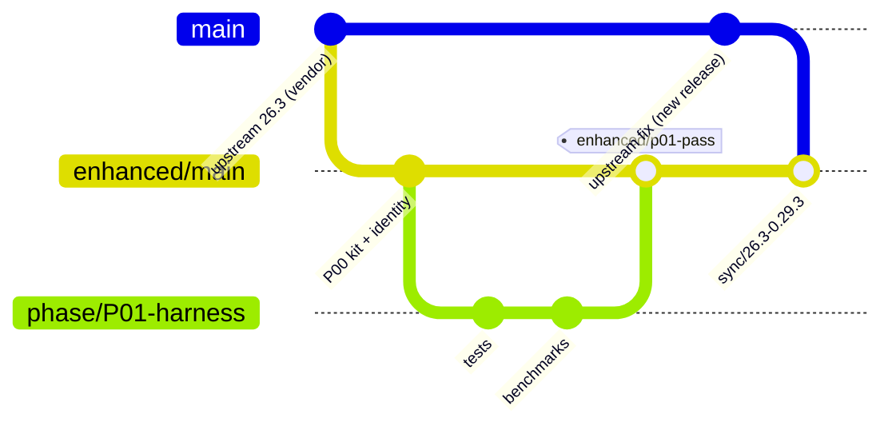

# 05 — GitHub Contribution Strategy: fork maintenance, upstream sync, Pull Requests

## 1. Upstream map

| Change concerns… | Target repository | Target branch | Notes |
|---|---|---|---|
| Litematica on modern Minecraft (bug fixes, small optimisations) | `sakura-ryoko/litematica` | current default (`26.3` today) | Fill in the PR template **including the AI disclosure**. Category A only, unless discussed first |
| MaLiLib (atomic file writes, shared helpers) | `sakura-ryoko/malilib` | current default (`26.3` today) | Keep changes minimal. They affect every masa mod |
| Architecture or design direction | Discussion with **both** maintainers (Sakura-Ryoko for modern versions, masa for direction) | — | Issue or Discord thread first. Frame it as *aligning with masa's rewrite*. No unsolicited large PRs |
| Servux/Syncmatica protocols | `sakura-ryoko/servux`, `sakura-ryoko/syncmatica` | default | Never change a wire format unilaterally |
| masa's rewrite (`maruohon/*@ornithe/1.12.2`) | Do not target | — | Read-only design donor. masa did not ask for help there |

> Re-check targets at the start of every contribution batch: default branches move with each Minecraft release (`26.2` → `26.3` → …), and maintainers can change policy.

## 2. Remotes and branches

```text
remotes
  origin            → github.com/<you>/<fork>             (your fork, push here only)
  upstream-sakura   → github.com/sakura-ryoko/litematica  (fetch only)
  upstream-masa     → github.com/maruohon/litematica      (fetch only, design reference)
  (MaLiLib: separate fork <you>/malilib with upstream-sakura → sakura-ryoko/malilib)

branches
  vendor/sakura-<mc>        pristine mirror of upstream-sakura/<mc> (fast-forward only, never commit)
  enhanced/main             fork integration branch (default branch on GitHub)
  phase/PXX-<slug>          one per phase, merged into enhanced/main after audit PASS
  <agent worktree branches> short-lived, merged into the phase branch by the lead
  upstream-pr/<topic>       cut from vendor/sakura-<mc>; minimal change for one upstream PR
  sync/<mc>-<upstream-tag>  temporary branch for merging a new upstream release
  port/<mc-version>         temporary branch for a Minecraft version port

tags
  baseline/sakura-26.3-0.29.2-sakura.1   pristine baseline (P00)
  enhanced/pXX-pass                       end of each passed phase
  enhanced/v<version>                     fork releases
```


*(In the diagram `main` stands for `vendor/sakura-26.3`.)*

### Initial setup (done by the P00 prompt, shown here for reference)
```bash
git clone https://github.com/<you>/<fork>.git && cd <fork>
git remote add upstream-sakura https://github.com/sakura-ryoko/litematica.git
git remote add upstream-masa   https://github.com/maruohon/litematica.git
git remote set-url --push upstream-sakura DISABLED   # push protection
git remote set-url --push upstream-masa   DISABLED
git fetch upstream-sakura 26.3
git switch -c vendor/sakura-26.3 upstream-sakura/26.3
git tag baseline/sakura-26.3-0.29.2-sakura.1
git switch -c enhanced/main
git config rerere.enabled true
```

## 3. Keeping the fork synchronisable

1. **Additive architecture.** New subsystems live in new packages and files. Upstream files get **thin seams** (one-line delegations to fork code) rather than large edits. The fewer upstream lines you touch, the cheaper every sync.
2. **Patch inventory.** `docs/enhanced/registers/upstream.md` keeps a table of every upstream file the fork modifies, with the reason, the size of the change and the seam pattern. The sync prompt uses it to predict conflicts.
3. **No mass reformatting**, no renaming of upstream classes, and no moving of upstream files unless an ADR justifies it (for example ARCH-02 splitting `LitematicaSchematic`). When such a move happens, do it in **one isolated commit** with only the move, so git can follow renames.
4. **`git rerere`** stays enabled, so repeated conflict resolutions are recorded.
5. **Cadence**:
   - **upstream sync** after each Sakura-Ryoko release (`prompts/recurring/upstream-sync.md`);
   - **Minecraft port** after each game drop (`prompts/recurring/mc-version-port.md`).
   Both run **between phases**, never in the middle of one.
6. **Conflict policy**: upstream behaviour wins unless the fork has a tested reason. Every resolved conflict in a fork-owned seam gets a test, if one does not exist yet.
7. **Upstream fixes first**: if upstream fixes something the fork also fixed, drop the fork's version and keep the test.

## 4. Classifying changes: A / B / C

| Category | Criteria (all must hold) | Examples | Route |
|---|---|---|---|
| **A: easy to upstream** | Small (≲ 200 changed lines), self-contained, no new dependency, no behaviour change except the fix, fits upstream style, reproducible problem, evidence available | REL-01 atomic save (MaLiLib), REL-02 overflow guard, REL-03 transmit slice index (after confirmation), PERF-02 safe default budget, specific Easy Place block-family fixes, crash fixes, translation fixes | `upstream-pr/<topic>` → PR |
| **B: needs discussion** | Changes architecture, threading, defaults, user habits or file layout; adds a dependency (even test-only); spans many files; or adds test infrastructure upstream does not have | Off-thread meshing, `Schematic` interface split, job system, test infrastructure, settings reorganisation, command palette, metadata index | Issue/Discord proposal with design doc + fork demo → PR only if invited, split into steps |
| **C: fork-only** | Major UI redesign, new visual identity, experimental features, features that conflict with upstream philosophy or that maintainers declined | New design system and screens, build assistant, layer sheets, profiles UX | Stays in the fork. Re-evaluate yearly |

Decision helper: *"Would a busy maintainer merge this in 10 minutes of review without changing their mind about anything?"* Yes → A. "Maybe, after a conversation" → B. "No" → C.

## 5. PR extraction workflow (fork change → upstream PR)

Use `prompts/recurring/pr-extraction.md`. Summary:
1. Start from `vendor/sakura-<mc>` (fresh fetch). Create `upstream-pr/<topic>`.
2. **Re-implement minimally** in upstream style. Never cherry-pick fork scaffolding: upstream has no fork services, flags or UI kit.
3. Evidence. Upstream has **no test source set**:
   - A PRs ship with reproduction steps, before/after evidence (logs, screenshots, timings with protocol) and, if useful, a *tiny* self-contained test proposal described in the PR text rather than imposed.
   - Proposing test infrastructure itself is a Category-B discussion.
4. Build the upstream branch exactly as upstream CI does (`./gradlew build`, Java 25), then play-test the specific scenario manually.
5. Write the PR with the template below. **One concern per PR.**
6. Open PRs **one or two at a time**. Wait for the maintainer's response before sending more. Never flood the maintainer.
7. Track every PR in `registers/upstream.md`: status, link, feedback. When upstream merges it, drop the fork's equivalent and rely on the next sync.

### PR description template (mirrors Sakura-Ryoko's template)
```markdown
## Pull Request Description
### Litematica - Overview
<one paragraph: problem, root cause, fix>

### Related Issues
- Closes #<issue> (or: "No issue yet — reproduction below")

### What Type of Change is This?
- [x] Bug Fix   - [ ] New Content   - [ ] Refactor / Optimization   - [ ] Translation / Assets   - [ ] Config / Build Script

### Reproduction & evidence
- Steps: …
- Before: … (log/screenshot/timing, protocol)
- After: …
- Tested on: MC 26.3, Fabric Loader x, MaLiLib y, mods: none / Sodium z

## AI Disclosure & Modrinth Compliance
- [ ] No AI was used …
- [x] **Code Generation:** <truthful description: e.g. "drafted with Claude Code; reviewed, tested and adjusted by <human>">
- [ ] Assets & Textures
- [ ] Core Functionality
- [x] **Documentation / Localization:** <if applicable>
**Briefly describe exactly what the AI tool assisted with:**
> <precise, honest description>
```

## 6. Talking to the maintainers
- **Before the first PR**: a short, polite introduction in the place the maintainers prefer (GitHub issue or masa's Discord channel for the mods). Say who you are, what the fork is, that it is unofficial, that AI tools are used and disclosed, and that you will send small, tested fixes. Ask whether they want them and **whether using "Litematica" in the fork's name is acceptable**.
- **For B proposals**: a one-page design note (problem, measurements, proposal, migration, risk, alternatives), a link to the fork's implementation, and an offer to split it. Accept "no" without pushback.
- **Security issues**: report privately first.
- Never ask maintainers to support fork users. The fork's README and `fabric.mod.json` point to the fork's own tracker.

## 7. Versioning and releases (fork)
- Version scheme: `MAJOR.MINOR.PATCH[-pre]+mc<version>` for the fork's own SemVer (e.g. `1.0.0-beta.2+mc26.3`). The upstream base (e.g. `sakura 0.29.2`) is recorded in the release notes and in `fabric.mod.json` custom metadata.
- Release channel at first: **GitHub Releases**, with the jar, sources jar, SHA-256 checksums, changelog, known issues, compat matrix and AI disclosure.
- Modrinth/CurseForge: decide in P19 after re-reading their current rules. Modrinth refuses projects whose contents are primarily AI output and bans AI-generated images on project pages.
- Pre-releases are tagged `-alpha`/`-beta`/`-rc`, and changelogs are grouped by Added/Changed/Fixed/Deprecated/Removed/Security.

## 8. Licence and attribution checklist (every release)
- [ ] `LICENSE.txt` (LGPL-3.0) unchanged and shipped in the jar
- [ ] `NOTICE.md`: original authors (masa, Sakura-Ryoko and the contributors listed in git history), statement that this is a modified version, date range of modifications, link to the source
- [ ] Modified files carry the modification notice chosen in P00
- [ ] Source code for the exact release is public (tag + sources jar)
- [ ] Third-party assets: licence recorded in `docs/enhanced/compat/assets.md`. No AI-generated art if targeting Modrinth
- [ ] `fabric.mod.json`: fork's name, id, contact and issue URLs; authors list includes the original authors; `provides` as decided in ADR
- [ ] AI disclosure updated (`AI_DISCLOSURE.md`, release notes)

## 9. If upstream diverges strongly
- If upstream rewrites a subsystem the fork also rewrote: compare both, keep the better one, and record an ADR. If upstream's version is comparable, switch to it to reduce the maintenance load.
- If masa's rewrite reaches modern Minecraft: plan a dedicated migration phase. The fork's rewrite-aligned designs should make it a *mapping* exercise, not a restart.
